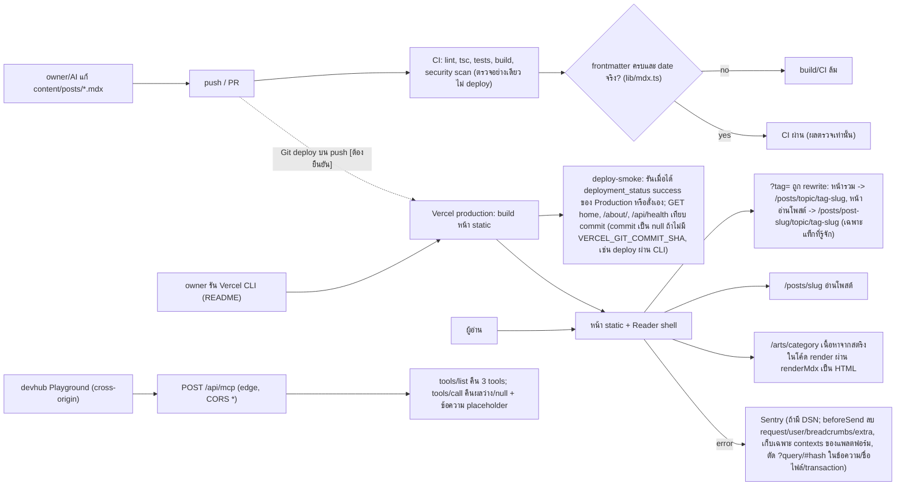
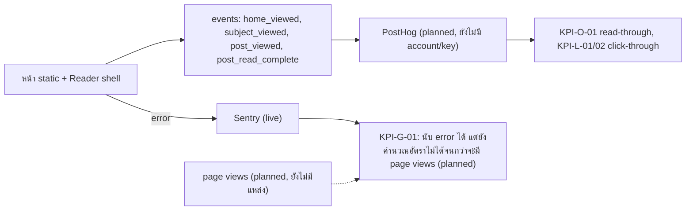

# 01 — Business process (As-Is / To-Be)

content-artblog-web คือเว็บบล็อกศิลปะและการออกแบบแบบอ่านอย่างเดียว (Next.js + MDX, artblog.bookchaowalit.com) สำหรับผู้เริ่มเรียนรู้งานสร้างสรรค์: โพสต์ MDX ในรีโปถูก build เป็นหน้า static และไม่มีบัญชี ฐานข้อมูล หรือ API ที่เขียนข้อมูล

Last reviewed: 2026-11-28 · commit `d3f9711`

## As-Is (จากโค้ดวันนี้)

Sources: `lib/mdx.ts`, `lib/tag-routes.ts`, `next.config.ts`, `app/api/mcp/route.ts`, `app/api/health/route.ts`, `app/arts/[category]/page.tsx`, `app/layout.tsx`, `lib/sentry.ts`, `.github/workflows/ci.yml`, `.github/workflows/deploy-smoke.yml`, `scripts/deploy-smoke.sh`, `README.md`, `PRODUCT.md`

หมายเหตุจากโค้ด/เอกสาร:

- `/api/mcp` เป็น stub: `tools/list` คืนเครื่องมือสามตัว แต่ `tools/call` คืนผลว่าง ไม่อ่านโพสต์จริง
- README/PRODUCT (2026-10-23) ระบุว่า push เข้า main ไม่ deploy (Vercel ผูกชื่อรีโปเก่า) แต่ workflow deploy-smoke สมมติว่า Vercel deploy main ผ่าน Git: สถานะจริงตอนนี้ [ต้องยืนยัน]
- ไม่มีการส่ง analytics event; ที่ commit นี้ app/layout.tsx ไม่ได้ mount Vercel Analytics/Speed Insights และ package.json ไม่มีแพ็กเกจทั้งสอง (production ตอนนี้รัน build ไหน [ต้องยืนยัน])

## To-Be (docs/measurement/KPI-PLAN.md, status approved)

Sources: `docs/measurement/KPI-PLAN.md`

## Gap

| ID | As-Is → To-Be | Status | Owner | Evidence |
|---|---|---|---|---|
| G1 | ไม่มี analytics event → ส่ง post_viewed / post_read_complete ฯลฯ ไป PostHog ตามแผน KPI | blocked | owner | `docs/measurement/KPI-PLAN.md` (ยังไม่มี PostHog account/project key, consent ยังไม่ตัดสิน) |
| G2 | `/api/mcp` เป็น stub คืนผลว่าง → ไม่มี To-Be เขียนไว้ว่าจะทำจริงหรือเอาออก | decide | owner | `app/api/mcp/route.ts`; `PRODUCT.md` §What does not work |
| G3 | สถานะ deploy ไม่ตรงกันระหว่างเอกสาร (CLI เท่านั้น) กับ workflow (Git deploy) → owner ยืนยันและผูก Vercel Git | decide | owner | `README.md` §Deployment; `.github/workflows/deploy-smoke.yml`; `PRODUCT.md` (D9) |

## Open questions

- Vercel project ผูก Git แล้วหรือยัง และ production ตอนนี้รัน commit ไหน (เปิด `/api/health` เพื่อดู)
- cover image ชี้ไฟล์ที่ไม่มี (`PRODUCT.md`): ไม่มี To-Be ที่เขียนไว้ว่าจะแก้
